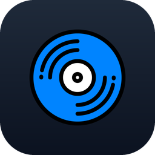
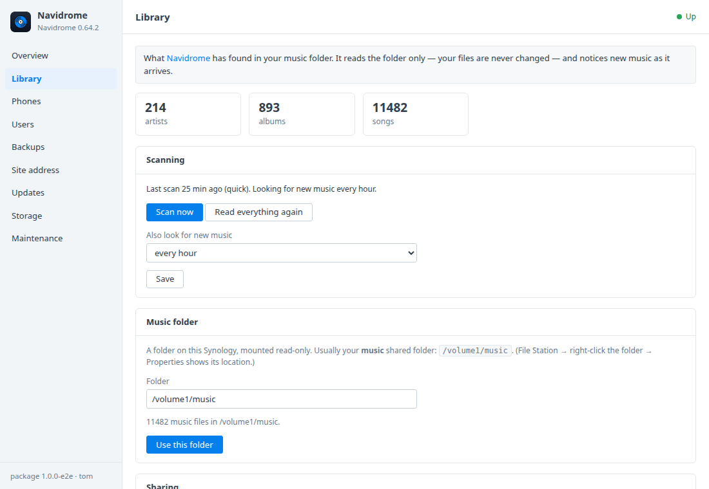
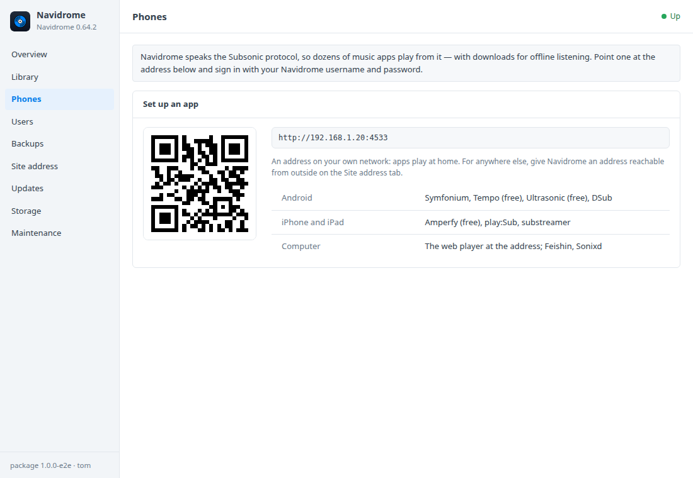
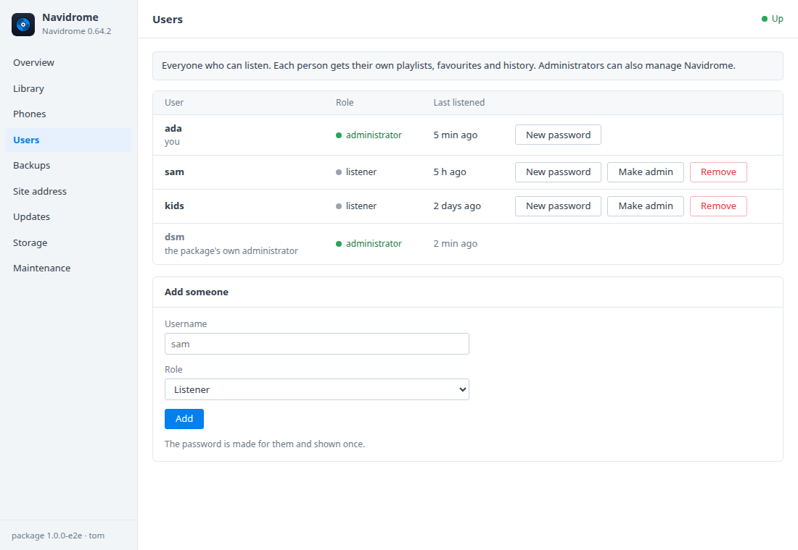

# Navidrome for Synology DSM

A DSM 7 package that installs [Navidrome](https://www.navidrome.org) in
Container Manager. Navidrome turns the music already in your shared folder
into your own streaming service: a fast web player, plus every Subsonic app
on Android and iPhone. It reads your music folder and never changes your
files. A **Navidrome** window in DSM covers:
- the library and scans;
- setting up phones with a QR code;
- users;
- share links;
- HTTPS with DSM's certificate;
- backups and updates.

Built on the [DSM app chassis](https://github.com/tombruton87/dsm-app-chassis).

## Download

### **[⬇ Download navidrome.spk](https://github.com/tombruton87/navidrome-dsm/releases/latest/download/navidrome.spk)**

[](https://github.com/tombruton87/navidrome-dsm/releases/latest)

That link always gives the newest version. Older ones are on the
[Releases](https://github.com/tombruton87/navidrome-dsm/releases) page.

Install: Package Center → Manual Install → the `.spk` (DSM 7.2.1+; Container
Manager is installed first if missing). The wizard asks for:
- the NAS's address;
- a port (4533 by default);
- a time zone;
- your music folder (usually `/volume1/music`);
- your username;
- HTTPS.

Your account is made at the first start, with a strong password shown once in
the window.

## What the DSM window adds

- **Library**
  - What Navidrome found: artists, albums and songs.
  - The last scan; **Scan now** or read everything again; and how often it
    looks for new music.
  - Change the music folder. A folder that isn't there is refused, never
    created.
  - Songs that left the folder are counted separately. Navidrome keeps their
    plays and ratings in case they come back.
  - Turn share links on or off.
- **Phones** — the address as a QR code, and the Subsonic apps that work well
  on Android, iPhone and desktop.
- **Users** — add people (each gets their own playlists, favourites and
  history), with a password made for them and shown once. You can also make a
  new password, make or unmake an administrator, or remove someone. Your own
  account and the package's own administrator are protected.
- **Site address** — HTTPS served by Navidrome itself with DSM's certificate
  (the system default; renewals are picked up daily) or a self-signed one. The
  QR code follows the address.
- **Backups, updates, storage, maintenance** — one file holds:
  - a consistent copy of the library database (playlists, favourites,
    ratings, play counts, users);
  - Navidrome's settings.

  Backups run nightly or on demand, with restore. The music itself stays where
  it is. You can also:
  - update to newer images or a newer package from inside DSM;
  - make a redacted support report;
  - read the logs;
  - remove Navidrome and everything with it.

If the music folder is missing at install (no *music* shared folder yet),
Navidrome starts with an empty library. It picks the folder up within ten
minutes of it appearing.

## Screenshots

| | |
|---|---|
|  |  |
|  | |

## How it works

Navidrome (`deluan/navidrome`) runs as one container:
- its database is in the `navidrome_data` volume;
- your music folder is bind-mounted read-only at `/music`.

The window works through Navidrome's own API, with a package administrator
called *dsm* whose password is kept root-only in the package's settings.
Scans go through the Subsonic API. Your own password is never stored.

## Layout

```
chassis/          the DSM app chassis (git submodule)
package.conf      name, title, services, volumes, images, port, texts
app/compose.yaml  Navidrome
setup/app.sh      the hooks: accounts, library, music folder, users, HTTPS, backups
ui/               Library, Phones and Users tabs; CGI validation (free text travels base64url)
wizard/           the Navidrome page of the install wizard
tests/            steps for the chassis harness, with tiny MP3s made on the spot
```

Test: `chassis/tests/e2e.sh . up && chassis/tests/e2e.sh . act` on any Linux
box with Docker.

Release: bump `VERSION`, add the changes to `CHANGELOG.md`, build, then attach
the package twice, under its versioned name and as `navidrome.spk`:

```bash
cp dist/navidrome-X.Y.Z-1.spk /tmp/navidrome.spk
gh release create vX.Y.Z dist/navidrome-X.Y.Z-1.spk /tmp/navidrome.spk
```

Build: `chassis/build.sh . N`.

## Credits

The icon is Navidrome's own mark on a dark DSM-style tile. Navidrome is
GPL-3.0 software by Deluan Quintão and contributors. This package is not
affiliated with Navidrome or Synology.
